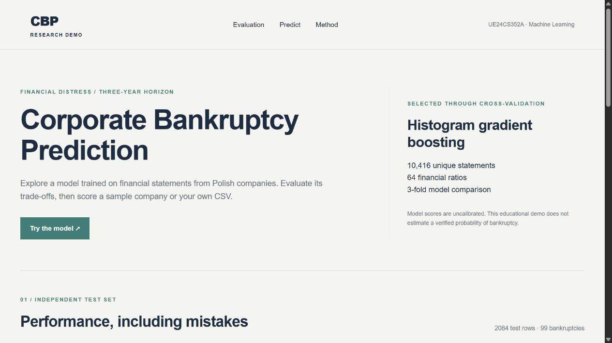
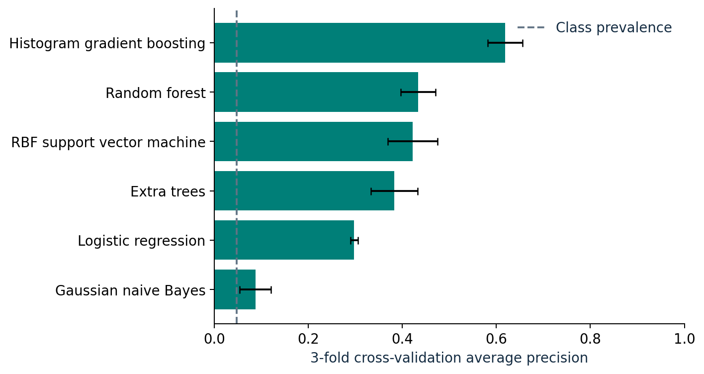

# Corporate Bankruptcy Prediction

**UE24CS352A - Machine Learning mini-project**  
Predicting bankruptcy within three years from financial ratios, with an emphasis on rare-event detection and reproducible evaluation.



## Team

| Student | SRN |
|---|---|
| Atharva Ashish Vyas | PES1UG24CS093 |
| Atharva Rakesh Bhidre | PES1UG24CS095 |

**Repository:** [https://github.com/Atharva-Ashish-Vyas/corporate-bankruptcy-prediction](https://github.com/Atharva-Ashish-Vyas/corporate-bankruptcy-prediction)

**Submission files:** [Two-page write-up](deliverables/writeup_two_pages.pdf) · [One-page alternative](deliverables/writeup_one_page.pdf) · [PowerPoint](deliverables/presentation.pptx) · [Slide PDF](deliverables/presentation.pdf)

## Verified result

The selected **histogram gradient boosting** model detects **84 of 99** bankrupt statements in the independent test split. The decision rule was chosen using development data and was frozen before test evaluation.

| Held-out metric | Result |
|---|---:|
| Bankruptcy recall | 84.8% |
| Precision | 34.3% |
| Average precision | 0.750 |
| ROC AUC | 0.968 |
| F2 | 0.655 |
| False alarms / missed bankruptcies | 161 / 15 |
| Test statements / positive labels | 2,084 / 99 |

An always non-bankrupt classifier reaches **95.25% accuracy but 0% recall**. Our screening threshold improves detection at the expense of false alarms. Scores are uncalibrated model outputs, not verified probabilities of bankruptcy.

## Quick start

Use **Python 3.12**. The source data and trained model are included, so you do not need to train before running the demo.

```powershell
python -m venv .venv
.venv\Scripts\Activate.ps1
python -m pip install -r requirements.txt
python app.py
```

Open **http://127.0.0.1:5000**. Choose a real held-out example, or upload `examples/sample_companies.csv`. The app scores the file and lets you download all predictions. Press Ctrl+C in the terminal to stop it.

On macOS/Linux, activate with `source .venv/bin/activate`. If PowerShell activation is restricted, run `.venv\Scripts\python.exe -m pip install -r requirements.txt` and `.venv\Scripts\python.exe app.py` directly.

## Reproduce and inspect

```text
python run.py train
python run.py predict --input examples/sample_companies.csv --output predictions.csv
python -m pip install -r requirements-dev.txt
python -m pytest -q
```

Training compares all six models and regenerates the saved model, results, data audit, split manifest, examples, and figures. It takes approximately a few minutes on an ordinary CPU; measured timings are in `reports/model_comparison.csv`. Pinning package versions supports reproducibility, though floating-point results can differ slightly across platforms.

## Experiment design

1. Load the official `3year.arff`: 10,503 statements, 64 predictors, 495 positive labels.
2. Remove 87 exact duplicate statements before splitting. The cleaned set contains 10,416 statements and 493 positive labels.
3. Reserve 20% (2,084 rows) as a stratified test set with seed 42. Use the other 8,332 rows for model selection.
4. Compare logistic regression, Gaussian naive Bayes, RBF SVM, random forest, extra trees, and histogram gradient boosting using identical three-fold stratified development splits.
5. Select the highest mean cross-validation average precision. Set the threshold to maximize F2 on that model's development out-of-fold predictions.
6. Fit the selected model on the development set, freeze it, and evaluate on the test set. Do not refit on the test set.

Imputation and scaling are inside model pipelines and are fitted separately within each training fold. Histogram gradient boosting handles missing values natively. The model has no access to test labels during selection or threshold choice.



## What to submit and push

| Deliverable | Location |
|---|---|
| Original source and setup instructions | `src/`, `run.py`, `app.py`, this README |
| Interactive local demo | `templates/`, `static/`, `examples/` |
| Dataset and attribution | `data/raw/3year.arff`, `data/README.md` |
| Trained model and checksum | `models/` |
| Executed analysis notebook | `notebooks/01_analysis.ipynb` |
| Full evaluation and editable figures | `reports/` |
| Two-page write-up and one-page alternative | `deliverables/` |
| Editable presentation and slide PDF | `deliverables/` |
| Tests and GitHub Actions | `tests/`, `.github/workflows/tests.yml` |
| GitHub upload and faculty sharing steps | `docs/github_submission.md` |
| Demo script and Q&A preparation | `docs/demo_and_viva.md` |
| Team contribution record | `docs/team_contributions.md` |

Push the **contents of this repository folder**, including the hidden `.github`, `.gitignore`, and `.gitattributes` files. The dataset and selected model are small enough for ordinary Git. Do not push a virtual environment, caches, or uploaded company files.

## Scope and limitations

The project evaluates a historical Polish company dataset. It does not establish performance for another country, industry mix, or future period. Company IDs are absent, so exact duplicate removal cannot guarantee that all statements from one company stay in a single partition. The holdout is random rather than chronological. The 95% bootstrap intervals condition on this trained model and split; they do not measure uncertainty from retraining or dataset shift.

At the fixed 0.5 threshold, the same test model has 68.7% recall and 65.4% precision. At the development-selected threshold (0.1980), recall rises to 84.8% and precision falls to 34.3%. The selected threshold does not maximize F2 on the test set; we retain it to respect the experiment protocol. See `docs/model_card.md` for the detailed trade-off.

## Attribution

Dataset: Sebastian Tomczak (2016), *Polish Companies Bankruptcy*, UCI Machine Learning Repository, [DOI: 10.24432/C5F600](https://doi.org/10.24432/C5F600), CC BY 4.0.

Background references: [codeatri/Bankruptcy_Prediction](https://github.com/codeatri/Bankruptcy_Prediction) and the supplied *Corporate Bankruptcy Prediction* report by Neha Abajirao Patil. This implementation, experiment, and reporting were rebuilt independently. Source code uses the MIT license; the dataset retains its separate CC BY 4.0 license.
